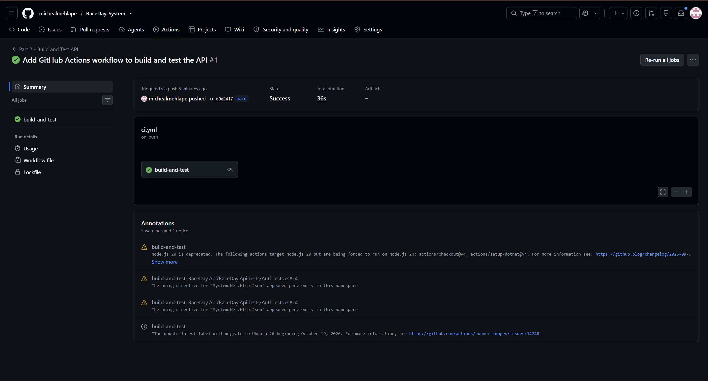

## Part 1 - Planning and database design

RaceDay is a race-event management system that lets **Organisers** create and
manage running events, and lets **Participants** browse events, enrol in a
category, and view their results. This repository contains Part 1: the
system planning and database design for RaceDay, produced before any
application code was written.

## Roles

| Role | Can do |
|---|---|
| **Organiser** | Create/update/delete their own events and categories, view enrolments for their categories, and capture results. |
| **Participant** | Browse public events and categories, enrol in a category, view and cancel their own enrolments, and view results/leaderboards. |

## Repository structure

```
/docs
  erd.png              -> Entity Relationship Diagram
  endpoint_plan.md      -> Full API endpoint plan (Section B)
  raceday_schema.sql    -> Database creation + seed script (Section C)
/.github/workflows
  validate.yml           -> checks that /docs contains the required files
README.md
```

## Database design

The database has six entities: **Users, Events, EventOrganisers, Categories,
Enrolments, Results**. See `docs/erd.png` for the full diagram, including
primary keys, foreign keys, and relationship cardinality. `EventOrganisers`
is a junction table that models the many-to-many relationship between
Organisers and Events (an event can have more than one organiser assisting
it, and an organiser can help run more than one event), in addition to each
event's single primary `OrganiserID`.


## CI/CD

A GitHub Actions workflow (`.github/workflows/validate.yml`) runs on every
push/PR to `main` and confirms that the `/docs` folder exists and contains
the ERD, endpoint plan, and SQL script, and that `README.md` exists at the
repository root.


## Video walkthrough

Video walking through the  ERD Diagram, endpoint plan choices, and a live run of the SQL script in SSMS:

`> https://youtu.be/iHSIG5ppvxs `


## Part 2 - RaceDay REST API

An ASP.NET Core Web API (.NET 10) with Entity Framework Core (code-first) on SQL Server.
It provides everything the RaceDay platform needs: accounts, events, categories, enrolments and results.

### The two roles

| Role | Can do |
|---|---|
| **Organiser** | Create, edit and delete their own events and categories; view all enrolments for their events; capture results |
| **Participant** | Browse events and categories; enrol in a category (a bib number is generated); view and cancel their own enrolments; view their own results |

Anyone, logged in or not, can browse events, categories and results leaderboards.
Role rules are enforced in the API: no session returns 401, the wrong role returns 403,
and an Organiser touching another Organiser's event also returns 403.

### How authentication works

- Passwords are hashed with PBKDF2 (random salt per user) and the plain password is never stored.
- Logging in creates a server-side session holding the user ID and role, sent back as a cookie.
- Registering as an **Organiser** needs an access code (`OrganiserAccessCode` in `appsettings.json`),
  so nobody can make themselves an Organiser just by choosing the role.

### Setup and run

Requirements: .NET 10 SDK, SQL Server (LocalDB is fine), Visual Studio 2026 or the `dotnet` CLI.

1. Clone the repository.
2. Open `RaceDay.Api/RaceDay.Api.slnx`.
3. Check the connection string in `RaceDay.Api/RaceDay.Api/appsettings.json`.
   The default is `(localdb)\MSSQLLocalDB` with a database named `RaceDayApiDB`.
4. Create the database. In the Package Manager Console (default project `RaceDay.Api`): `Update-Database`
   or from a terminal in the API project folder: `dotnet ef database update`
5. Run the API (F5, or `dotnet run`).
6. Open Swagger at `https://localhost:7014/swagger`.
   (The port may differ on your machine, so check the console output.)

To try an Organiser account, register with role `Organiser` and the code from `appsettings.json`.

### Running the tests

```
dotnet test RaceDay.Api/RaceDay.Api.slnx
```

36 xUnit tests cover registration and login, event management, role-based rejection and enrolments.
They run the real API in memory against an in-memory database. The in-memory provider does not enforce
SQL Server rules such as unique indexes, so the API checks those cases in code and the tests cover that.

### CI/CD

GitHub Actions builds the solution and runs all tests on every push.



### Changes from the Part 1 plan

See [docs/part2-changes.md](docs/part2-changes.md) for every deliberate change and the reason for it.

### Video

https://youtu.be/vr5e4cKd5dM

### AI use disclosure

I used an AI assistant (Claude) for guidance while building Part 2: explanations of the concepts,
debugging and test cases.

